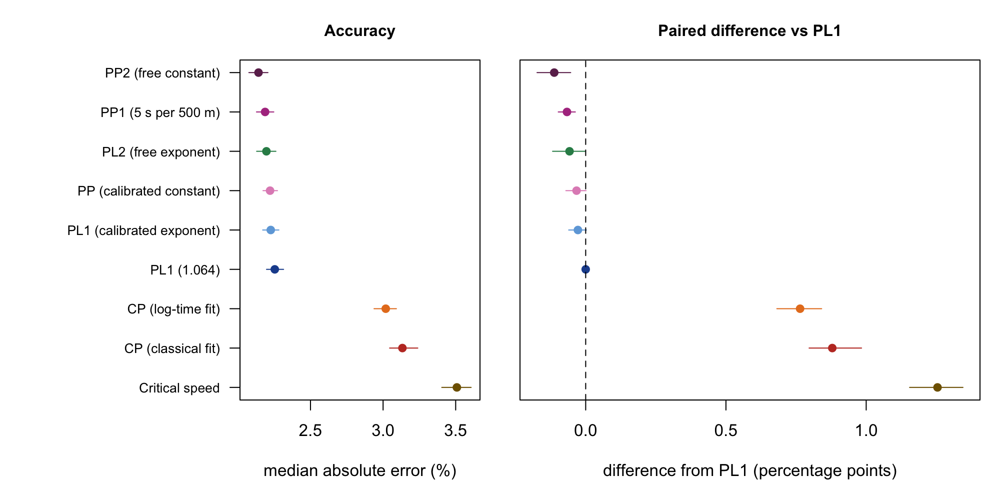
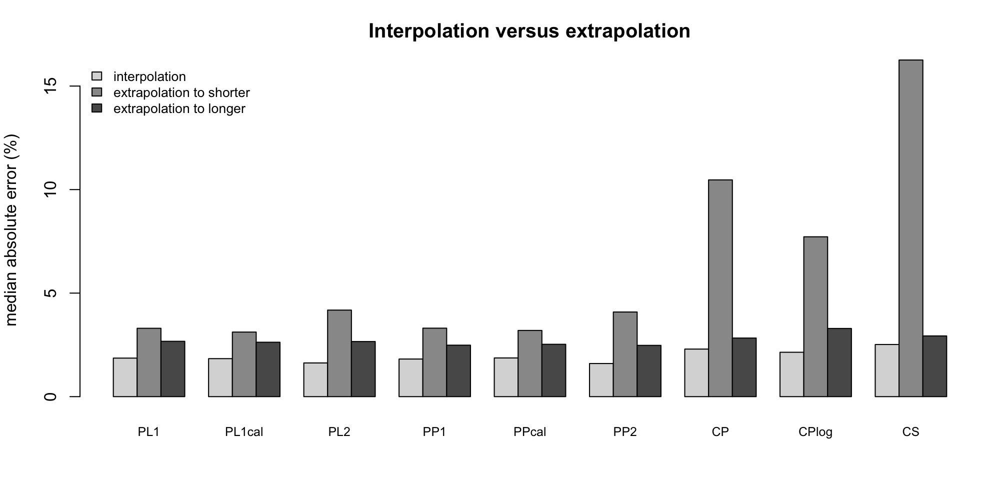
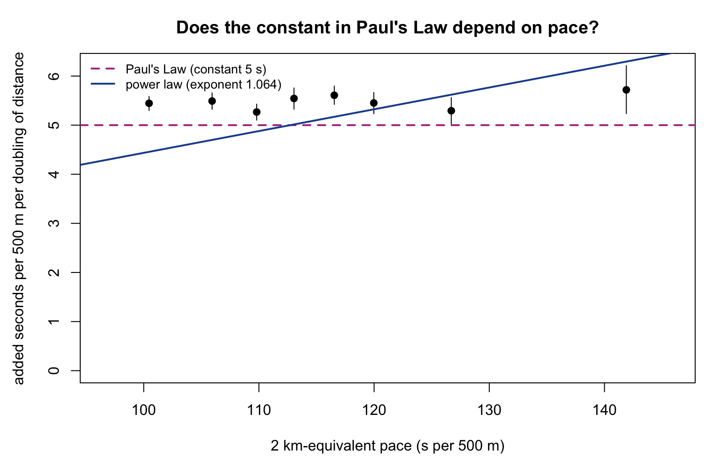

# Does erg performance follow a 1.064 power law?

An empirical test, using verified results from the public [Concept2 rankings](https://log.concept2.com/rankings), of the hypothesis that for one athlete in one season, time on the RowErg grows with distance as

$$t \propto d^{\,1.064}$$

Equivalently, average pace scales as $d^{0.064}$ and average power as $d^{-0.192}$.

The analysis covers season 2026, both sexes and all age groups, and is built as a small pipeline: a cached scraper (R), an analysis script (R, base packages only) and a report (Typst) that reads the results files directly. A second part compares the power law with Paul's Law and with a critical-power model as predictors of held-out efforts.

The idea to validate a power law comes from the paper below which compares a
power law against another popular method to characterize human endurance: the
_Critical Power Model_. In rowing, a third model is 
[Paul's Law](https://github.com/lindig/pauls-law/), which I had investigated before.

> Drake, J.P., Finke, A. & Ferguson, _R.A. Modelling human endurance:
> power laws vs critical power_. Eur J Appl Physiol 124, 507–526 (2024).
> [https://doi.org/10.1007/s00421-023-05274-5](https://doi.org/10.1007/s00421-023-05274-5)

## Key findings

Based on 3,993 athlete-seasons with at least three verified events spanning at least a threefold range of distances.

1. **On average the exponent is close to 1.064.** The pooled within-athlete exponent is **1.067** (95% CI 1.066–1.068). Using 1.064 instead changes a time predicted from a 2 km result by about 0.3% at 6 km and 0.5% at 10 km.
2. **It is not one constant across athletes.** The exponent falls with age, from 1.085 (ages 19–29) to 1.060 (60+), and women are 0.003–0.009 lower than men of the same age group. The age gradient is still there when the comparison is made inside fixed distance windows, so it is not just a different mix of events. The value 1.064 happens to match the 50–59 age group.
3. **It depends on distance.** The local exponent at 2 km is 1.071 and it falls by about 0.010 for every doubling of distance (about 1.09 around 500 m and about 1.05 around 10 km). A single power law fits a limited range of distances, and the pooled slope depends on which events are included.
4. **Not every logged result is an all-out effort**, which adds noise and a bias of unknown sign. The residuals do show a tail of unusually slow results, but a robust regression, dropping the worst-fitting athletes, and using distance events only move the pooled exponent by at most 0.003 ([Sub-maximal efforts](#sub-maximal-efforts)). This cannot rule out efforts that are consistently easy.

**Predicting performance** ([section below](#predicting-performance-power-law-pauls-law-and-critical-power)): each model is fitted to an athlete's other efforts and predicts a held-out one.

5. **Paul's Law is, to first order, a power law whose exponent depends on pace**: β ≈ 1 + 5 / (ln 2 × pace in s per 500 m), so 1.064 corresponds to a 2 km time of about 7:31. As predictors the two laws are within about 0.1 percentage point of each other (median error about 2.2%). With the published constants Paul's Law is slightly but clearly better (2.19% against 2.25%), and from a single 2 km result too (2.29% against 2.47%). The difference disappears when both laws are calibrated by sex and age group.
6. **The constant in Paul's Law is about 5.5 s per 500 m rather than 5, and it does not depend on pace.** Binned by pace, the added time per doubling is flat (weighted sum of squares 11 against 149 for the proportional form that a power law implies), which supports Paul's assumption. It does depend on age, from about 6.5 s under 30 to about 5.2 s from 50.
7. **A critical-power model was clearly worse at prediction** (median error 3.0–3.1% against 2.25%, about 35–40% higher), mainly because it extrapolates poorly to shorter efforts. A free exponent or constant per athlete helps interpolation but not extrapolation, so a calibrated one-parameter law is about as good as the two-parameter versions.

The full write-ups, with the same tables and figures, are `report.typ` (power-law validation) and `report_cp.typ` (model comparison); compile them with `typst compile`.

## Contents

- [Model](#model)
- [Data](#data)
- [Method](#method)
- [Results](#results)
- [Predicting performance: power law, Paul's Law and critical power](#predicting-performance-power-law-pauls-law-and-critical-power)
- [Limitations](#limitations)
- [Reproducing the analysis](#reproducing-the-analysis)

## Model

For athlete-season $i$ with results $j$:

$$\ln t_{ij} = a_i + b\,\ln\!\left(\frac{d_{ij}}{2000\ \mathrm{m}}\right) + \varepsilon_{ij}$$

and the test is $b = 1.064$. Timed events (4, 30 and 60 minutes) enter as the pair (fixed time, distance rowed); distance events as (nominal distance, time).

To look for departures from a straight line a quadratic term is added, with $x = \ln(d/2000)$:

$$\ln t_{ij} = a_i + b\,x_{ij} + c\,x_{ij}^2 + \varepsilon_{ij}$$

Then $b$ is the local exponent at 2 km and $2c$ is how quickly the local exponent changes with $\ln d$.

## Data

**Source.** RowErg rankings, season 2026 (the Concept2 season, not the calendar year), downloaded with the "Verified Only" and "RowErg only" filters. Each ranking lists a person's best verified result per event and season. Only individual results that carry an athlete identifier are used; race-verified rows mostly lack one and cannot be linked reliably across events.

**Events.** The extremes (1 minute, 100 m, half marathon, marathon, 100 km) were left out on purpose: they are dominated by anaerobic capacity, pacing and endurance limits that no single power law is expected to cover. What remains spans roughly 500 m to 10 km (4 to 60 minutes; the 60-minute event reaches about 14 km).

| Event | Athlete-seasons (verified) | In analysis |
|---|---:|---:|
| 500 m | 3,761 | 2,021 |
| 1000 m | 4,869 | 2,390 |
| 4 min | 996 | 667 |
| 2000 m | 5,704 | 2,780 |
| 5000 m | 6,051 | 2,549 |
| 6000 m | 2,532 | 1,295 |
| 30 min | 5,840 | 2,190 |
| 10,000 m | 5,610 | 2,260 |
| 60 min | 2,737 | 1,294 |

**Eligibility.** An athlete-season is analysed if it has at least three events whose longest and shortest distances differ by a factor of at least 3, so that a slope is identifiable.

| Step | Rows | Athlete-seasons |
|---|---:|---:|
| Rows in CSV | 41,712 | 18,985 |
| With an athlete id | 38,435 | 18,985 |
| Verified individual results | 38,103 | 18,903 |
| RowErg (static) only | 38,103 | 18,903 |
| One result per athlete-season-event | 38,100 | 18,903 |
| ≥ 3 events and distance ratio ≥ 3 | 17,446 | 3,993 |

**Who is in the sample.** About 21% of verified athlete-seasons qualify. The analysed sample is 83% men and 77% aged 40 or over (3,298 men and 695 women). Qualifying athletes look typical for their 2 km time:

| Group | Sex | n | Median 2 km time (s) |
|---|---|---:|---:|
| All verified athletes with a 2 km result | F | 1,216 | 539.05 |
| Athletes in the analysis | F | 526 | 531.05 |
| All verified athletes with a 2 km result | M | 4,488 | 448.90 |
| Athletes in the analysis | M | 2,254 | 449.05 |

## Method

- **Per-athlete exponents.** Each athlete-season gets its own least-squares slope; the median and mean are reported.
- **Pooled within-athlete exponent.** $\sum S_{xy} / \sum S_{xx}$ over athlete-seasons, which removes each athlete's overall level and weights athletes by the spread of their distances.
- **Confidence intervals.** Cluster bootstrap (2,000 resamples) that resamples *athletes*, so an athlete with several seasons is not counted as independent. These intervals reflect sampling variation only, not model error.
- **Distance dependence.** The quadratic model above, pooled and by group. Separately, for every event the exponent implied between an athlete's 2 km result and that event, $\ln(t_e/t_0)/\ln(d_e/d_0)$, plus the percentage by which the time differs from the 1.064 prediction.
- **Event mix.** Because curvature makes the slope depend on which events an athlete rowed, the age and sex comparison is repeated inside fixed distance windows (1–10 km and 2–21 km).
- **Effort sensitivity.** The estimates are recomputed with a Huber-robust regression, after dropping the worst-fitting 10% and 25% of athlete-seasons, using efforts up to 6 km only, and using distance events only.

## Results

### Overall

| Group | Athletes | Median slope | Pooled exponent | 95% CI |
|---|---:|---:|---:|---|
| All | 3,993 | 1.067 | 1.067 | 1.066–1.068 |


### Age and sex

Pooled within-athlete exponent (all events). "Exponent at 2 km" is the local exponent from the quadratic model.

| Group | Athletes | Pooled exponent | 95% CI | Exponent at 2 km |
|---|---:|---:|---|---:|
| Women | 695 | 1.060 | 1.057–1.063 | 1.061 |
| Men | 3,298 | 1.069 | 1.068–1.070 | 1.073 |
| ≤ 18 | 99 | 1.082 | 1.076–1.088 | 1.081 |
| 19–29 | 181 | 1.085 | 1.081–1.090 | 1.088 |
| 30–39 | 638 | 1.077 | 1.075–1.080 | 1.082 |
| 40–49 | 1,074 | 1.069 | 1.067–1.071 | 1.073 |
| 50–59 | 1,039 | 1.064 | 1.062–1.066 | 1.068 |
| 60+ | 962 | 1.060 | 1.058–1.062 | 1.064 |

By sex and age group (athletes in brackets; groups under 30 athletes have no interval):

| Age | Women | Men |
|---|---|---|
| ≤ 18 | n/a (18) | 1.083 [1.077, 1.089] (81) |
| 19–29 | 1.083 [1.069, 1.097] (30) | 1.086 [1.081, 1.090] (151) |
| 30–39 | 1.071 [1.066, 1.077] (95) | 1.078 [1.076, 1.081] (543) |
| 40–49 | 1.061 [1.056, 1.066] (184) | 1.070 [1.068, 1.073] (890) |
| 50–59 | 1.056 [1.049, 1.062] (163) | 1.065 [1.063, 1.067] (876) |
| 60+ | 1.054 [1.050, 1.058] (205) | 1.062 [1.060, 1.064] (757) |


**Is the age gradient just an event-mix artefact?** Older athletes tend to row longer events, and because the exponent falls with distance (next section) that alone could produce a gradient. Repeating the comparison inside fixed distance windows says it does not:

| Group | All events | 1–10 km window | 2–21 km window | Exponent at 2 km |
|---|---:|---:|---:|---:|
| All | 1.067 | 1.060 | 1.063 | 1.071 |
| Women | 1.060 | 1.056 | 1.061 | 1.061 |
| Men | 1.069 | 1.061 | 1.064 | 1.073 |
| ≤ 18 | 1.082 | 1.081 | 1.093 | 1.081 |
| 19–29 | 1.085 | 1.079 | 1.084 | 1.088 |
| 30–39 | 1.077 | 1.068 | 1.071 | 1.082 |
| 40–49 | 1.069 | 1.061 | 1.065 | 1.073 |
| 50–59 | 1.064 | 1.057 | 1.059 | 1.068 |
| 60+ | 1.060 | 1.054 | 1.054 | 1.064 |

Why the exponent depends on age and sex was not tested. Training history, event specialisation and body mass (not available in the rankings) are all candidates.

### Distance dependence

The quadratic model gives a local exponent at 2 km of **1.071** (95% CI 1.070–1.072) and a curvature of **−0.0072** (−0.0081 to −0.0064), i.e. the local exponent changes by about −0.010 per doubling of distance. Predicted time as a multiple of the 2 km time, constant 1.064 against the curved model:

| Distance | Constant 1.064 | Curved model | Difference |
|---|---:|---:|---:|
| 500 m | 0.229 | 0.223 | −2.3% |
| 1000 m | 0.478 | 0.474 | −0.8% |
| 5000 m | 2.651 | 2.652 | +0.0% |
| 6000 m | 3.219 | 3.215 | −0.1% |
| 10,000 m | 5.542 | 5.500 | −0.8% |

The exponent implied between each athlete's 2 km result and each other event (median, with 95% bootstrap interval). Positive percentages mean the actual time was slower than the 1.064 prediction.

| Event | n | Implied exponent | 95% CI | Median time vs prediction |
|---|---:|---:|---|---:|
| 500 m | 1,480 | 1.090 | 1.088–1.093 | −3.6% |
| 1000 m | 1,757 | 1.065 | 1.063–1.068 | −0.1% |
| 4 min | 430 | 1.044 | 1.039–1.051 | +1.2% |
| 5000 m | 2,336 | 1.056 | 1.055–1.058 | −0.7% |
| 6000 m | 925 | 1.064 | 1.062–1.067 | +0.0% |
| 30 min | 1,615 | 1.065 | 1.063–1.066 | +0.1% |
| 10,000 m | 1,697 | 1.059 | 1.058–1.061 | −0.8% |
| 60 min | 859 | 1.064 | 1.062–1.066 | +0.1% |


Pooled exponent in different distance windows (distance actually rowed, athletes with at least three events and a distance ratio of at least 2 inside the window):

| Window | Athletes | Pooled exponent | 95% CI |
|---|---:|---:|---|
| All events | 4,555 | 1.067 | 1.066–1.068 |
| 500 m – 10 km | 4,207 | 1.067 | 1.066–1.068 |
| 1 km – 10 km | 3,468 | 1.060 | 1.059–1.061 |
| 2 km – 21 km | 2,930 | 1.063 | 1.062–1.065 |
| ≤ 6 km | 2,471 | 1.070 | 1.069–1.072 |

The window changes the pooled exponent by about 0.010, which is more than the gap between the overall estimate and 1.064. The hypothesis is therefore best stated for a defined range of distances, not as a universal constant.

### Sub-maximal efforts

The hypothesis describes maximal efforts, but a logged verified result can be an easy piece. Because each ranking keeps an athlete's best verified result for an event and season, repeated easy sessions are mostly filtered out, but an athlete whose only verified 10 km is a steady row still contributes it. The sign of the resulting bias depends on where it occurs: easy long efforts raise the implied exponent, easy short efforts lower it, and an easy 2 km anchor shifts every implied exponent.

To see how much the answer depends on unusual results, the estimates were recomputed under four alternatives (from `results/effort_sensitivity.csv`):

| Variant | Athletes | Linear exponent | Exponent at 2 km | Curvature |
|---|---:|---|---|---:|
| Baseline (least squares) | 3,993 | 1.067 [1.066, 1.068] | 1.071 [1.070, 1.072] | −0.0072 |
| Huber-robust regression | 3,993 | 1.067 [1.066, 1.068] | 1.071 [1.070, 1.072] | −0.0074 |
| Drop worst-fitting 10% of athletes | 3,593 | 1.068 [1.067, 1.069] | 1.072 [1.071, 1.073] | −0.0078 |
| Drop worst-fitting 25% of athletes | 2,995 | 1.067 [1.066, 1.068] | 1.071 [1.070, 1.072] | −0.0086 |
| Efforts ≤ 6 km only | 2,471 | 1.070 [1.069, 1.072] | 1.068 [1.066, 1.069] | −0.0142 |
| Distance events only (no timed events) | 3,234 | 1.068 [1.067, 1.069] | 1.070 [1.069, 1.072] | −0.0094 |


The pooled exponent stays within 0.003 of the baseline in every variant. The residual scatter of an athlete-season around its fitted curve has a median of 1.8% per result, a 90th percentile of 5.4% and a 99th percentile of 12.9%, and the pooled residuals are skewed towards slow results (skewness +1.41). That is the signature one would expect from occasional sub-maximal efforts, but down-weighting or removing the worst-fitting athletes barely changes the estimates.

These checks show that the estimates are not driven by unusual results; they cannot prove that the remaining results are maximal, for instance if an athlete's long efforts were all submaximal. Read the numbers as exponents of *typical verified efforts*.

## Predicting performance: power law, Paul's Law and critical power

The power law above has one free parameter per athlete (the level). Two natural rivals are [Paul's Law](https://github.com/lindig/pauls-law/), which adds a fixed 5 s per 500 m to the pace for every doubling of distance,

$$t_1 = d_1\left(\frac{t_0}{d_0} + \frac{1}{100}\log_2\frac{d_1}{d_0}\right),$$

and the critical-power (CP) model, $P = \mathrm{CP} + W'/t$ with $P = 2.8\,(d/t)^3$, which has two parameters. This part of the repository tests how well each predicts an effort that was held out.

### Paul's Law is a power law with a pace-dependent exponent

A power law multiplies the pace, $p_1 = p_0 (d_1/d_0)^{\beta-1}$; Paul's Law adds to it. For distance ratios near 1 the two agree when

$$\beta = 1 + \frac{c}{p_0 \ln 2},$$

with $c$ Paul's constant (5 s per 500 m) and $p_0$ the pace in the same units. Slower athletes therefore get smaller exponents:

| 2 km time | Pace (s/500 m) | Equivalent exponent |
|---|---:|---:|
| 6:30 | 97.5 | 1.074 |
| 7:00 | 105.0 | 1.069 |
| 7:30 | 112.5 | 1.064 |
| 8:00 | 120.0 | 1.060 |
| 9:00 | 135.0 | 1.053 |

An exponent of 1.064 is Paul's Law at 112.7 s per 500 m, a 2 km time of 7:30.8. Over a finite distance range the equivalent exponent is a little smaller than the local one, because Paul's pace increase is linear in $\ln d$ while the power law's is exponential. Paul's Law also has a built-in concavity in the log-log plot (the local exponent falls by $(\beta-1)^2$ per unit of $\ln d$) that a constant-exponent power law lacks; the curvature found above is of that kind.

Using the median 2 km times of the analysed athletes (449 s for men, 531 s for women), Paul's published constant implies exponents of 1.064 and 1.054; the observed pooled exponents are 1.069 and 1.060. With the constants fitted below (5.43 and 5.73 s) the implied values are 1.070 and 1.062.

### Models and design

| Model | Parameters per athlete | Notes |
|---|---|---|
| PL1 | 1 (level) | exponent fixed at 1.064 |
| PL1 calibrated | 1 | exponent per sex and age group, from other athletes only |
| PL2 | 2 | free exponent |
| PP1 | 1 | Paul's Law, 5 s per 500 m |
| PP calibrated | 1 | constant per sex and age group, from other athletes only |
| PP2 | 2 | free constant |
| CP (classical, log-time fit) | 2 | CP and W′; the log-time fit uses the same loss as the power laws |
| Critical speed | 2 | $d = D' + \mathrm{CS}\cdot t$ |

Each athlete-season (the same 3,993 as above) has each event held out in turn. Every model is fitted to the remaining events and predicts the time for the held-out distance (for a timed event, the time to row the distance achieved, compared with the fixed time). Errors are the predicted time over the observed time minus one. Calibrated constants are cross-fitted: an athlete's own group constant is estimated without that athlete. Intervals are cluster bootstraps over athletes and model comparisons are paired.

### Accuracy

17,230 held-out efforts, median absolute error of the predicted time:

| Model | Median error | 90th percentile | Bias | Within 1% | Difference vs PL1 (pp) | Closer than PL1 |
|---|---:|---:|---:|---:|---|---:|
| PP2 (free constant) | 2.14% | 8.7% | +0.15% | 27% | −0.11 [−0.17, −0.05] | 51% |
| PP1 (5 s per 500 m) | 2.19% | 7.6% | +0.06% | 25% | −0.07 [−0.10, −0.04] | 53% |
| PL2 (free exponent) | 2.20% | 8.8% | +0.16% | 26% | −0.06 [−0.12, −0.00] | 50% |
| PP calibrated | 2.22% | 7.3% | +0.16% | 25% | −0.03 [−0.07, +0.00] | 52% |
| PL1 calibrated | 2.23% | 7.4% | +0.12% | 25% | −0.03 [−0.06, +0.00] | 53% |
| **PL1 (1.064)** | 2.25% | 7.6% | +0.09% | 24% | – | – |
| CP (log-time fit) | 3.02% | 11.5% | −0.29% | 20% | +0.76 [+0.68, +0.84] | 40% |
| CP (classical fit) | 3.13% | 13.8% | −0.48% | 19% | +0.88 [+0.80, +0.98] | 38% |
| Critical speed | 3.51% | 20.7% | −0.60% | 17% | +1.25 [+1.15, +1.34] | 34% |



The power laws and Paul's Law are close: the differences are about 0.1 percentage point, about 0.3 s on a 7:30 2 km, though they are statistically clear in the like-for-like comparisons:

| Comparison (a vs b) | Error a vs b | Difference a − b (pp) |
|---|---|---|
| Paul vs power law, fixed constants | 2.19% vs 2.25% | −0.07 [−0.10, −0.04] |
| Paul vs power law, both calibrated | 2.22% vs 2.23% | −0.00 [−0.03, +0.02] |
| Paul vs power law, both free per athlete | 2.14% vs 2.20% | −0.05 [−0.08, −0.03] |
| Paul (free) vs critical power | 2.14% vs 3.02% | −0.88 [−0.94, −0.80] |
| Critical power vs power law (free exponent) | 3.02% vs 2.20% | +0.82 [+0.75, +0.90] |
| Paul vs power law, from the 2 km result alone (9,803 predictions) | 2.29% vs 2.47% | −0.18 [−0.22, −0.14] |

Predicting from the 2 km result alone is worse than using all the athlete's other efforts for both laws (2.47% against 2.17% for the power law, 2.29% against 2.11% for Paul), so a second well-chosen effort is worth having even for a one-parameter model.

### Interpolation and extrapolation

Median absolute error (%) by whether the held-out effort lies inside or outside the range of the training efforts:

| Held-out effort | n | PL1 | PL1 cal. | PL2 | PP1 | PP cal. | PP2 | CP | CP log | CS |
|---|---:|---:|---:|---:|---:|---:|---:|---:|---:|---:|
| Interpolation | 9,462 | 1.86 | 1.84 | 1.63 | 1.82 | 1.87 | **1.60** | 2.30 | 2.14 | 2.52 |
| Extrapolation to shorter | 3,775 | 3.30 | **3.12** | 4.18 | 3.31 | 3.20 | 4.09 | 10.47 | 7.72 | 16.26 |
| Extrapolation to longer | 3,993 | 2.67 | 2.63 | 2.66 | 2.49 | 2.53 | **2.48** | 2.83 | 3.29 | 2.93 |



- A free exponent or constant helps when interpolating (1.6% against about 1.85%) but hurts when extrapolating to shorter efforts (about 4.1% against 3.3%): with two or three training efforts the slope cannot be pinned down well enough.
- CP is the weakest family everywhere. Extrapolating to shorter efforts it predicts times far too fast (median bias −9.2% classical, −6.3% log-time fit), and for longer efforts too fast by about 2–3%.
- Paul's family is slightly better than the power laws when extrapolating to longer efforts (2.48–2.53% against 2.63–2.67%).

CP is normally applied to efforts of about 2 to 20 minutes, while the held-out events here run from about 1.5 to 60 minutes. Restricting the CP fit to training efforts of 2–20 minutes made it *worse* (3.61% on the 8,901 predictions where it exists, against 2.64% for the unrestricted log-time fit), because the fit then has fewer, narrower efforts and extrapolates more. A fairer test of CP on its own ground would score only held-out efforts of 2–20 minutes (the per-event results are in `results/cp_breakdowns.csv`); it has not been done here.

### The constant in Paul's Law

Estimated as the pooled within-athlete slope of pace on $\log_2$ distance:

| Group | Athletes | Constant (s per 500 m per doubling) |
|---|---:|---|
| All | 3,993 | **5.48** [5.38, 5.57] |
| Women | 695 | 5.73 [5.42, 6.05] |
| Men | 3,298 | 5.43 [5.34, 5.52] |
| ≤ 18 | 99 | 6.51 [5.97, 7.07] |
| 19–29 | 181 | 6.53 [6.16, 6.91] |
| 30–39 | 638 | 6.11 [5.88, 6.32] |
| 40–49 | 1,074 | 5.46 [5.29, 5.63] |
| 50–59 | 1,039 | 5.18 [5.01, 5.35] |
| 60+ | 962 | 5.26 [5.07, 5.45] |

The published 5 s is a little low for these athletes, and the constant is larger for younger athletes. Paul's Law and a power law differ on one assumption: whether the added time per doubling is the same for everyone (Paul) or grows in proportion to pace (power law). Binning athletes by their 2 km-equivalent pace gives:

| Pace bin (s/500 m) | Athletes | Median pace | Constant | Equivalent exponent |
|---|---:|---:|---|---:|
| 89–104 | 500 | 100 | 5.45 [5.30, 5.59] | 1.08 |
| 104–108 | 499 | 106 | 5.49 [5.32, 5.66] | 1.07 |
| 108–111 | 499 | 110 | 5.27 [5.10, 5.43] | 1.07 |
| 111–115 | 499 | 113 | 5.54 [5.32, 5.76] | 1.07 |
| 115–118 | 499 | 117 | 5.61 [5.42, 5.80] | 1.07 |
| 118–123 | 499 | 120 | 5.45 [5.23, 5.66] | 1.07 |
| 123–132 | 499 | 127 | 5.29 [5.02, 5.56] | 1.06 |
| 132–303 | 499 | 142 | 5.72 [5.24, 6.21] | 1.06 |



The constant is flat across paces. A single constant (5.45 s) fits the bins with a weighted sum of squares of 11; a constant proportional to pace (a power law, exponent 1.070) gives 149. So in these data Paul's structural assumption holds better than the power law's. The exponent still falls with pace (1.08 to 1.06 across the bins), as Paul's Law implies. The bins are few and the weights come from bootstrap intervals, so this is descriptive, not a formal test, and it is not adjusted for age. The age pattern in the constant (6.5 s for under 30s, 5.2 s for 50–59) cannot come from pace alone, since the median paces of the age groups are similar (107 to 120 s per 500 m).

### In-sample fit and parameters

Residual standard deviation of log time in the athlete's own data (degrees of freedom adjusted): PL1 2.74% and PP1 2.64% (one parameter each); PL2 1.89%, PP2 1.82%, CP (log-time fit) 2.41%, CP (classical) 4.26%, critical speed 6.09% (two parameters each). Among the two-parameter models the best in-sample fit is PL2 for 43% of athlete-seasons, CP log-time fit for 28%, PP2 for 26% and critical speed for 3%. Fitted to all of an athlete's events, the median free exponent is 1.07 (interquartile range 1.05–1.09) and the median free Paul constant 5.48 s (4.18–6.89). The median CP is 170 W and W′ is 19.3 kJ (interquartile range 12.9–28.1 kJ); 2% of classical CP fits had CP or W′ at the zero boundary.

### Reading the comparison

- **A second parameter buys little for prediction.** In the athlete's own data the free-exponent and free-constant models fit much better (1.9% against 2.7%), but out of sample they are no better than the calibrated one-parameter laws (PL2 2.20% and PP2 2.14% against 2.23% and 2.22%).
- **The choice between the power law and Paul's Law matters less than calibration.** The difference between the laws is about 0.1 percentage point; a better constant or exponent for the athlete's group is worth about the same.
- **CP does worse here, and the models share one limitation.** All assume maximal efforts, which are not guaranteed, and the athletes are mostly male masters rowers with at least three verified events across a threefold range of distance. CP in particular is judged here on events well outside its usual 2–20 minute range.

## Limitations

- **Non-maximal efforts** (above) add noise and a bias of unknown sign.
- **Selection.** Athletes choose their events. Only about one in five athlete-seasons qualifies, and the sample is mostly male and over 40. Results for women and for athletes under 30 rest on much smaller groups.
- **The 4-minute test is an outlier.** Its implied exponent (1.044) is clearly below the 1000 m value (1.065) although the two efforts last nearly the same time. This suggests the people who record verified 4-minute results are a different group, or that timed and distance results are not equivalent. It deserves a separate look before being interpreted physiologically.
- **Range.** The extremes were excluded by design. Extrapolating to the marathon or to 100 m is not supported, since the local exponent changes with distance.
- **One season** is analysed. Body mass, drag factor and training state are not available. Race-verified results were excluded because they cannot be linked to athletes. Age is as recorded in the ranking.
- **The curved model was not tested for prediction.** It describes these data better than a constant exponent; the prediction comparison below uses constant-exponent and Paul's Law models.

## Reproducing the analysis

### Requirements

- R ≥ 4.1 with `httr2`, `rvest` and `xml2` (`install.packages(c("httr2", "rvest", "xml2"))`). The optional mixed model uses `lme4` and is skipped if it is not installed. The analysis script otherwise uses base R only.
- [Typst](https://typst.app) to build the report.

### Files

| File | Purpose |
|---|---|
| `concept2_rankings.R` | Downloads the ranking lists into `cache/` (raw HTML, so re-runs resume and never re-download) and parses them to `data/rankings_long.csv` |
| `power_law_analysis.R` | Reads the CSV, fits the models, writes `results/` (tables, figures, `key_numbers.json`) |
| `cp_vs_powerlaw.R` | Sources `power_law_analysis.R`, then compares the power law, Paul's Law and critical-power models by leave-one-event-out prediction; writes `results/cp_*.csv`, `results/pp_*.csv`, `results/fig_cp_*.png`, `results/fig_pp_*.png` |
| `report.typ` | Typst report of the power-law validation, reading `results/` |
| `report_cp.typ` | Typst report of the model comparison (power law, Paul's Law, critical power) |
| `results/` | Tables (CSV), figures (PNG) and `key_numbers.json` |

### Steps

```sh
# 1. See the search form's parameter names and event codes
Rscript concept2_rankings.R inspect

# 2. Edit the config block at the top of concept2_rankings.R, then run it
#    (settings used here: SEASONS <- 2026; SEXES <- c("F", "M");
#     EVENTS <- c("4","30","60","500","1000","2000","5000","6000","10000");
#     EXTRA_QUERY <- list(status = "verified", rower = "rower"); MAX_PAGES <- Inf)
Rscript concept2_rankings.R

# 3. Analyse
Rscript power_law_analysis.R

# 4. Compare the power law, Paul's Law and critical power (sources power_law_analysis.R)
Rscript cp_vs_powerlaw.R

# 5. Build the reports
typst compile report.typ
typst compile report_cp.typ
```

The scraper waits about 2–3 seconds between requests, identifies itself with a User-Agent (set your contact address in `USER_AGENT`) and stops on HTTP errors; re-running resumes from the cache. Set `MAX_PAGES <- 2` first for a quick test.

### What to commit

The rankings data belongs to Concept2 and contains named individuals, so this repository does not redistribute it. Suggested `.gitignore`:

```
cache/
data/
results/athlete_fits.csv
```

`results/athlete_fits.csv` holds one row per athlete-season with the public athlete ID, so it is better kept out of the repository. Everything else in `results/` is aggregate. Check the Concept2 terms of use and `robots.txt` before running the scraper at scale.
