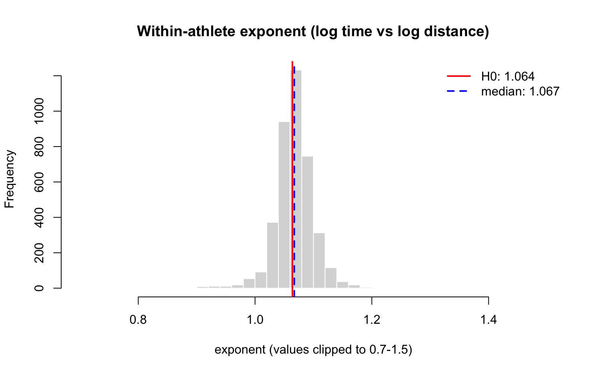
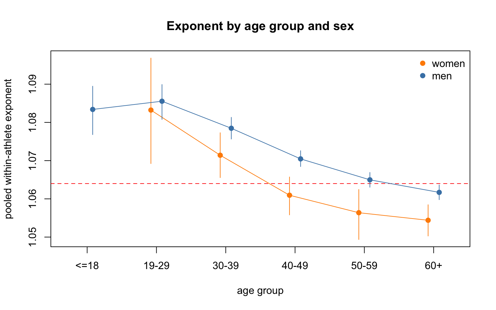
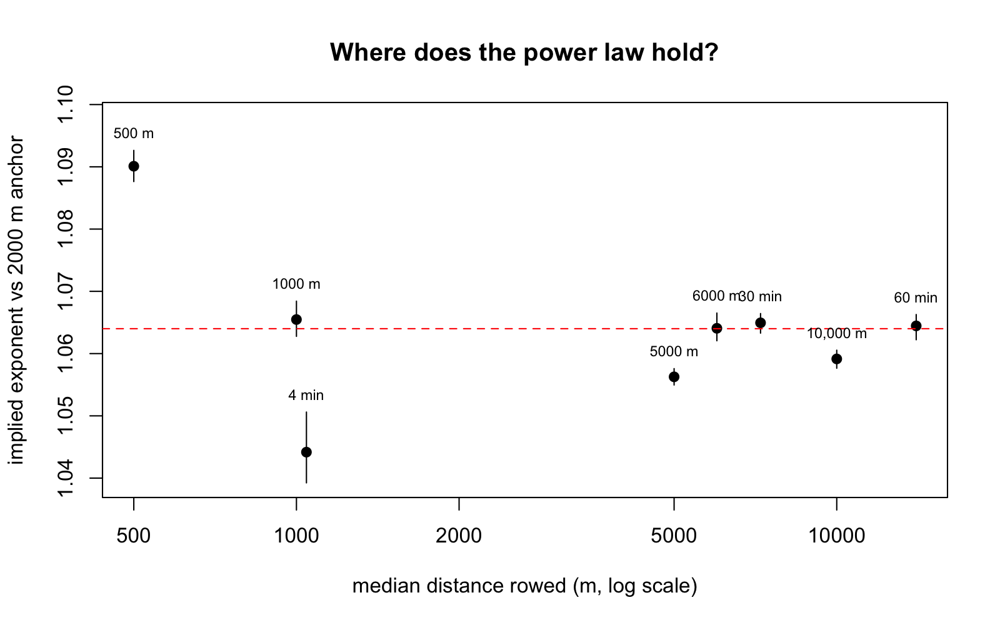
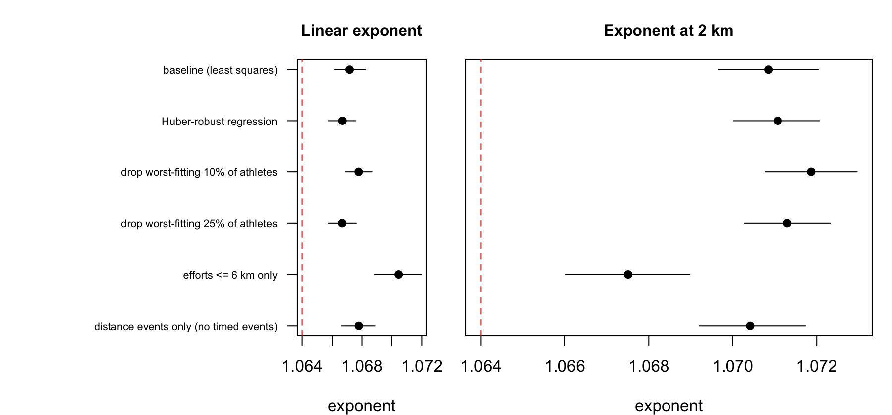

# Does erg performance follow a 1.064 power law?

An empirical test, using verified results from the public [Concept2
rankings](https://log.concept2.com/rankings), of the hypothesis that for one
athlete in one season, time on the RowErg grows with distance as

$$t \propto d^{\,1.064}$$

Equivalently, average pace scales as $d^{0.064}$ and average power as $d^{-0.192}$.

The analysis covers season 2026, both sexes and all age groups, and is built as
a small pipeline: a cached scraper (R), an analysis script (R, base packages
only) and a report (Typst) that reads the results files directly.

The idea to validate a power law comes from the paper below which compares a
power law against another popular method to characterize human endurance: the
_Critical Power Model_. In rowing, a third model is [Paul's
Law])(https://github.com/lindig/pauls-law/) which I had investigated before.

> Drake, J.P., Finke, A. & Ferguson, _R.A. Modelling human endurance:
> power laws vs critical power_. Eur J Appl Physiol 124, 507–526 (2024).
> [https://doi.org/10.1007/s00421-023-05274-5]([https://doi.org/10.1007/s00421-023-05274-5])

## Key findings

Based on 3,993 athlete-seasons with at least three verified events spanning at least a threefold range of distances.

1. **On average the exponent is close to 1.064.** The pooled within-athlete exponent is **1.067** (95% CI 1.066–1.068). Using 1.064 instead changes a time predicted from a 2 km result by about 0.3% at 6 km and 0.5% at 10 km.
2. **It is not one constant across athletes.** The exponent falls with age, from 1.085 (ages 19–29) to 1.060 (60+), and women are 0.003–0.009 lower than men of the same age group. The age gradient is still there when the comparison is made inside fixed distance windows, so it is not just a different mix of events. The value 1.064 happens to match the 50–59 age group.
3. **It depends on distance.** The local exponent at 2 km is 1.071 and it falls by about 0.010 for every doubling of distance (about 1.09 around 500 m and about 1.05 around 10 km). A single power law fits a limited range of distances, and the pooled slope depends on which events are included.
4. **Not every logged result is an all-out effort**, which adds noise and a bias of unknown sign. Section [Sub-maximal efforts](#sub-maximal-efforts) describes how this was checked and what it cannot rule out.

The full write-up (with the same tables and figures) is `report.typ`; compile it with `typst compile report.typ`.

## Contents

- [Model](#model)
- [Data](#data)
- [Method](#method)
- [Results](#results)
- [Limitations](#limitations)
- [Reproducing the analysis](#reproducing-the-analysis)

## Model

For athlete-season $i$ with results $j$:

$$\ln t_{ij} = a_i + b\ln\left(\frac{d_{ij}}{2000\ \mathrm{m}}\right) + \varepsilon_{ij}$$

and the test is $b = 1.064$. Timed events (4, 30 and 60 minutes) enter as the
pair (fixed time, distance rowed); distance events as (nominal distance, time).

To look for departures from a straight line a quadratic term is added, with $x = \ln(d/2000)$:

$$\ln t_{ij} = a_i + b\,x_{ij} + c\,x_{ij}^2 + \varepsilon_{ij}$$

Then $b$ is the local exponent at 2 km and $2c$ is how quickly the local exponent changes with $\ln d$.

## Data

**Source.** RowErg rankings, season 2026 (the Concept2 season, not the calendar year), downloaded with the "Verified Only" and "RowErg only" filters. Each ranking lists a person's best verified result per event and season. Only individual results that carry an athlete identifier are used; race-verified rows mostly lack one and cannot be linked reliably across events.

**Events.** The extremes (1 minute, 100 m, half marathon, marathon, 100 km) were left out on purpose: they are dominated by anaerobic capacity, pacing and endurance limits that no single power law is expected to cover. What remains spans roughly 500 m to 10 km (4 to 60 minutes; the 60-minute event reaches about 14 km).

| Event | Athlete-seasons (verified) | In analysis |
|---|---:|---:|
| 500 m | 3,761 | 2,021 |
| 1000 m | 4,869 | 2,390 |
| 4 min | 996 | 667 |
| 2000 m | 5,704 | 2,780 |
| 5000 m | 6,051 | 2,549 |
| 6000 m | 2,532 | 1,295 |
| 30 min | 5,840 | 2,190 |
| 10,000 m | 5,610 | 2,260 |
| 60 min | 2,737 | 1,294 |

**Eligibility.** An athlete-season is analysed if it has at least three events whose longest and shortest distances differ by a factor of at least 3, so that a slope is identifiable.

| Step | Rows | Athlete-seasons |
|---|---:|---:|
| Rows in CSV | 41,712 | 18,985 |
| With an athlete id | 38,435 | 18,985 |
| Verified individual results | 38,103 | 18,903 |
| RowErg (static) only | 38,103 | 18,903 |
| One result per athlete-season-event | 38,100 | 18,903 |
| ≥ 3 events and distance ratio ≥ 3 | 17,446 | 3,993 |

**Who is in the sample.** About 21% of verified athlete-seasons qualify. The analysed sample is 83% men and 77% aged 40 or over (3,298 men and 695 women). Qualifying athletes look typical for their 2 km time:

| Group | Sex | n | Median 2 km time (s) |
|---|---|---:|---:|
| All verified athletes with a 2 km result | F | 1,216 | 539.05 |
| Athletes in the analysis | F | 526 | 531.05 |
| All verified athletes with a 2 km result | M | 4,488 | 448.90 |
| Athletes in the analysis | M | 2,254 | 449.05 |

## Method

- **Per-athlete exponents.** Each athlete-season gets its own least-squares slope; the median and mean are reported.
- **Pooled within-athlete exponent.** $\sum S_{xy} / \sum S_{xx}$ over athlete-seasons, which removes each athlete's overall level and weights athletes by the spread of their distances.
- **Confidence intervals.** Cluster bootstrap (2,000 resamples) that resamples *athletes*, so an athlete with several seasons is not counted as independent. These intervals reflect sampling variation only, not model error.
- **Distance dependence.** The quadratic model above, pooled and by group. Separately, for every event the exponent implied between an athlete's 2 km result and that event, $\ln(t_e/t_0)/\ln(d_e/d_0)$, plus the percentage by which the time differs from the 1.064 prediction.
- **Event mix.** Because curvature makes the slope depend on which events an athlete rowed, the age and sex comparison is repeated inside fixed distance windows (1–10 km and 2–21 km).
- **Effort sensitivity.** The estimates are recomputed with a Huber-robust regression, after dropping the worst-fitting 10% and 25% of athlete-seasons, using efforts up to 6 km only, and using distance events only.

## Results

### Overall

| Group | Athletes | Median slope | Pooled exponent | 95% CI |
|---|---:|---:|---:|---|
| All | 3,993 | 1.067 | 1.067 | 1.066–1.068 |



### Age and sex

Pooled within-athlete exponent (all events). "Exponent at 2 km" is the local exponent from the quadratic model.

| Group | Athletes | Pooled exponent | 95% CI | Exponent at 2 km |
|---|---:|---:|---|---:|
| Women | 695 | 1.060 | 1.057–1.063 | 1.061 |
| Men | 3,298 | 1.069 | 1.068–1.070 | 1.073 |
| ≤ 18 | 99 | 1.082 | 1.076–1.088 | 1.081 |
| 19–29 | 181 | 1.085 | 1.081–1.090 | 1.088 |
| 30–39 | 638 | 1.077 | 1.075–1.080 | 1.082 |
| 40–49 | 1,074 | 1.069 | 1.067–1.071 | 1.073 |
| 50–59 | 1,039 | 1.064 | 1.062–1.066 | 1.068 |
| 60+ | 962 | 1.060 | 1.058–1.062 | 1.064 |

By sex and age group (athletes in brackets; groups under 30 athletes have no interval):

| Age | Women | Men |
|---|---|---|
| ≤ 18 | n/a (18) | 1.083 [1.077, 1.089] (81) |
| 19–29 | 1.083 [1.069, 1.097] (30) | 1.086 [1.081, 1.090] (151) |
| 30–39 | 1.071 [1.066, 1.077] (95) | 1.078 [1.076, 1.081] (543) |
| 40–49 | 1.061 [1.056, 1.066] (184) | 1.070 [1.068, 1.073] (890) |
| 50–59 | 1.056 [1.049, 1.062] (163) | 1.065 [1.063, 1.067] (876) |
| 60+ | 1.054 [1.050, 1.058] (205) | 1.062 [1.060, 1.064] (757) |



**Is the age gradient just an event-mix artefact?** Older athletes tend to row longer events, and because the exponent falls with distance (next section) that alone could produce a gradient. Repeating the comparison inside fixed distance windows says it does not:

| Group | All events | 1–10 km window | 2–21 km window | Exponent at 2 km |
|---|---:|---:|---:|---:|
| All | 1.067 | 1.060 | 1.063 | 1.071 |
| Women | 1.060 | 1.056 | 1.061 | 1.061 |
| Men | 1.069 | 1.061 | 1.064 | 1.073 |
| ≤ 18 | 1.082 | 1.081 | 1.093 | 1.081 |
| 19–29 | 1.085 | 1.079 | 1.084 | 1.088 |
| 30–39 | 1.077 | 1.068 | 1.071 | 1.082 |
| 40–49 | 1.069 | 1.061 | 1.065 | 1.073 |
| 50–59 | 1.064 | 1.057 | 1.059 | 1.068 |
| 60+ | 1.060 | 1.054 | 1.054 | 1.064 |

Why the exponent depends on age and sex was not tested. Training history, event specialisation and body mass (not available in the rankings) are all candidates.

### Distance dependence

The quadratic model gives a local exponent at 2 km of **1.071** (95% CI 1.070–1.072) and a curvature of **−0.0072** (−0.0081 to −0.0064), i.e. the local exponent changes by about −0.010 per doubling of distance. Predicted time as a multiple of the 2 km time, constant 1.064 against the curved model:

| Distance | Constant 1.064 | Curved model | Difference |
|---|---:|---:|---:|
| 500 m | 0.229 | 0.223 | −2.3% |
| 1000 m | 0.478 | 0.474 | −0.8% |
| 5000 m | 2.651 | 2.652 | +0.0% |
| 6000 m | 3.219 | 3.215 | −0.1% |
| 10,000 m | 5.542 | 5.500 | −0.8% |

The exponent implied between each athlete's 2 km result and each other event (median, with 95% bootstrap interval). Positive percentages mean the actual time was slower than the 1.064 prediction.

| Event | n | Implied exponent | 95% CI | Median time vs prediction |
|---|---:|---:|---|---:|
| 500 m | 1,480 | 1.090 | 1.088–1.093 | −3.6% |
| 1000 m | 1,757 | 1.065 | 1.063–1.068 | −0.1% |
| 4 min | 430 | 1.044 | 1.039–1.051 | +1.2% |
| 5000 m | 2,336 | 1.056 | 1.055–1.058 | −0.7% |
| 6000 m | 925 | 1.064 | 1.062–1.067 | +0.0% |
| 30 min | 1,615 | 1.065 | 1.063–1.066 | +0.1% |
| 10,000 m | 1,697 | 1.059 | 1.058–1.061 | −0.8% |
| 60 min | 859 | 1.064 | 1.062–1.066 | +0.1% |



Pooled exponent in different distance windows (distance actually rowed, athletes with at least three events and a distance ratio of at least 2 inside the window):

| Window | Athletes | Pooled exponent | 95% CI |
|---|---:|---:|---|
| All events | 4,555 | 1.067 | 1.066–1.068 |
| 500 m – 10 km | 4,207 | 1.067 | 1.066–1.068 |
| 1 km – 10 km | 3,468 | 1.060 | 1.059–1.061 |
| 2 km – 21 km | 2,930 | 1.063 | 1.062–1.065 |
| ≤ 6 km | 2,471 | 1.070 | 1.069–1.072 |

The window changes the pooled exponent by about 0.010, which is more than the gap between the overall estimate and 1.064. The hypothesis is therefore best stated for a defined range of distances, not as a universal constant.

### Sub-maximal efforts

The hypothesis describes maximal efforts, but a logged verified result can be an easy piece. Because each ranking keeps an athlete's best verified result for an event and season, repeated easy sessions are mostly filtered out, but an athlete whose only verified 10 km is a steady row still contributes it. The sign of the resulting bias depends on where it occurs: easy long efforts raise the implied exponent, easy short efforts lower it, and an easy 2 km anchor shifts every implied exponent.

To see how much the answer depends on unusual results, the estimates were recomputed under four alternatives (Huber-robust regression, dropping the worst-fitting 10% and 25% of athlete-seasons, efforts up to 6 km only, distance events only). The comparison is in `results/effort_sensitivity.csv`:



<!-- TODO: add one sentence here summarising how far the estimates move (see results/effort_sensitivity.csv and key_numbers.json: effort.* for the residual scatter and skewness). -->

These checks show how sensitive the estimates are to unusual results; they cannot prove that the remaining results are maximal. Read the numbers as exponents of *typical verified efforts*.

## Limitations

- **Non-maximal efforts** (above) add noise and a bias of unknown sign.
- **Selection.** Athletes choose their events. Only about one in five athlete-seasons qualifies, and the sample is mostly male and over 40. Results for women and for athletes under 30 rest on much smaller groups.
- **The 4-minute test is an outlier.** Its implied exponent (1.044) is clearly below the 1000 m value (1.065) although the two efforts last nearly the same time. This suggests the people who record verified 4-minute results are a different group, or that timed and distance results are not equivalent. It deserves a separate look before being interpreted physiologically.
- **Range.** The extremes were excluded by design. Extrapolating to the marathon or to 100 m is not supported, since the local exponent changes with distance.
- **One season** is analysed. Body mass, drag factor and training state are not available. Race-verified results were excluded because they cannot be linked to athletes. Age is as recorded in the ranking.
- **Prediction accuracy was not tested.** The curved model describes these data better than a constant exponent; whether it predicts new athletes better was not evaluated.

## Reproducing the analysis

### Requirements

- R ≥ 4.1 with `httr2`, `rvest` and `xml2` (`install.packages(c("httr2", "rvest", "xml2"))`). The optional mixed model uses `lme4` and is skipped if it is not installed. The analysis script otherwise uses base R only.
- [Typst](https://typst.app) to build the report.

### Files

| File | Purpose |
|---|---|
| `concept2_rankings.R` | Downloads the ranking lists into `cache/` (raw HTML, so re-runs resume and never re-download) and parses them to `data/rankings_long.csv` |
| `power_law_analysis.R` | Reads the CSV, fits the models, writes `results/` (tables, figures, `key_numbers.json`) |
| `report.typ` | Typst report that reads `results/` and builds the full write-up |
| `results/` | Tables (CSV), figures (PNG) and `key_numbers.json` |

### Steps

```sh
# 1. See the search form's parameter names and event codes
Rscript concept2_rankings.R inspect

# 2. Edit the config block at the top of concept2_rankings.R, then run it
#    (settings used here: SEASONS <- 2026; SEXES <- c("F", "M");
#     EVENTS <- c("4","30","60","500","1000","2000","5000","6000","10000");
#     EXTRA_QUERY <- list(status = "verified", rower = "rower"); MAX_PAGES <- Inf)
Rscript concept2_rankings.R

# 3. Analyse
Rscript power_law_analysis.R

# 4. Build the report
typst compile report.typ
```

The scraper waits about 2–3 seconds between requests, identifies itself with a User-Agent (set your contact address in `USER_AGENT`) and stops on HTTP errors; re-running resumes from the cache. Set `MAX_PAGES <- 2` first for a quick test.
